 

 

  

 

## 🧠 Competências

| | Competência | Onde aparece |
|---|---|---|
| 📐 | **Arquitetura de software** — documento de arquitetura, ADRs, modelagem MER/DER, contrato de API | [CondomiFacil](https://github.com/pedrolems/CondomiFacil), [Unishop](https://github.com/Franmagno06/Unishop) |
| 📝 | **Documentação de software** — visão de produto, PRD, regras de negócio, histórias de usuário com critérios de aceite, README de nível de produto | [CondomiFacil](https://github.com/pedrolems/CondomiFacil), [AutomaticPointsCounter](https://github.com/pedrolems/AutomaticPointsCounter) |
| 🎯 | **Engenharia de requisitos** — requisitos funcionais, não funcionais e de segurança rastreáveis até as histórias | [CondomiFacil](https://github.com/pedrolems/CondomiFacil) |
| 🤖 | **Desenvolvimento com IA** — Claude Code e Codex no fluxo, com `CLAUDE.md`, `AGENTS.md` e skills versionadas no repositório | [CondomiFacil](https://github.com/pedrolems/CondomiFacil), [Unishop](https://github.com/Franmagno06/Unishop) |
| 🌐 | **Full-stack e entrega** — TypeScript, PostgreSQL, Docker, deploy na Vercel e Supabase, pagamentos com Mercado Pago | [Unishop](https://github.com/Franmagno06/Unishop) |
| 📱 | **Apps mobile** — React Native + Expo, autenticação e dados com Firebase | [CultureExplorer](https://github.com/pedrolems/CultureExplorer) |
| 🧱 | **Motor de domínio desacoplado e testes** — regras do tênis isoladas da interface e cobertas por testes automatizados | [AutomaticPointsCounter](https://github.com/pedrolems/AutomaticPointsCounter) |

 

## ⚡ Stack

 

## 🚀 Projetos em destaque

<table>
<tr>
<td width="50%" valign="top">

### 🛍️ [Unishop](https://github.com/Franmagno06/Unishop)
E-commerce para alunos da Unifor comprarem e venderem materiais dentro do campus. Em equipe, em produção de demonstração com API, banco PostgreSQL, pagamentos Mercado Pago e painel admin.

`TypeScript` `React` `PostgreSQL` `Docker`

</td>
<td width="50%" valign="top">

### 🏢 [CondomiFacil](https://github.com/pedrolems/CondomiFacil)
Gestão de condomínios para o Brasil, com 11 perfis de usuário, portaria offline, reservas, assembleias e cobrança. Fase de design: 139 requisitos funcionais, 71 histórias de usuário, arquitetura, ADRs e modelo de dados.

`Documentação` `Arquitetura` `Protótipo`

</td>
</tr>
<tr>
<td width="50%" valign="top">

### 🎾 [AutomaticPointsCounter](https://github.com/pedrolems/AutomaticPointsCounter)
Placar de tênis com juiz virtual que anuncia o placar por voz. Cobre tiebreaks, set decisivo, ordem de saque e troca de lado, com motor independente da interface, em português e inglês.

`Python` `Tkinter` `pytest`

</td>
<td width="50%" valign="top">

### 🌍 [CultureExplorer](https://github.com/pedrolems/CultureExplorer)
App mobile para descobrir e avaliar teatros, cinemas, museus e eventos, com perfis de visitante e administrador, busca, filtros e autenticação via Firebase.

`React Native` `Expo` `Firebase`

</td>
</tr>
</table>

[**→ Ver todos os repositórios**](https://github.com/pedrolems?tab=repositories)

 

  

